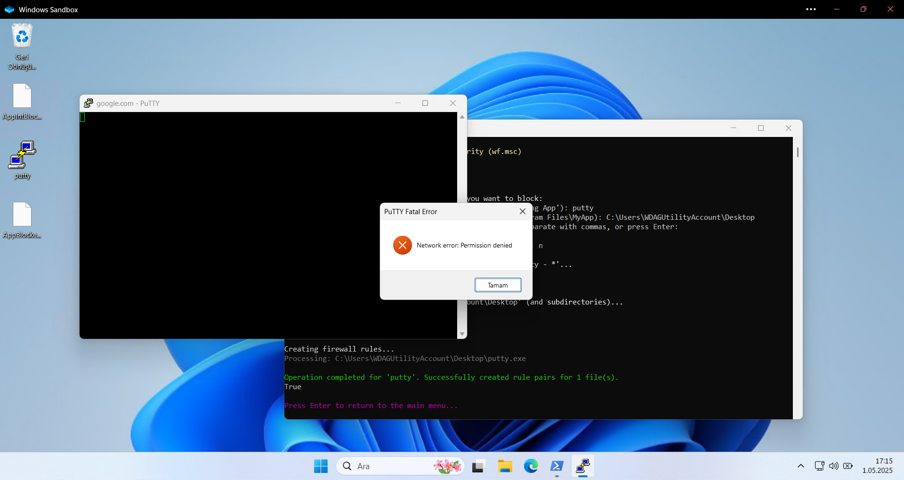
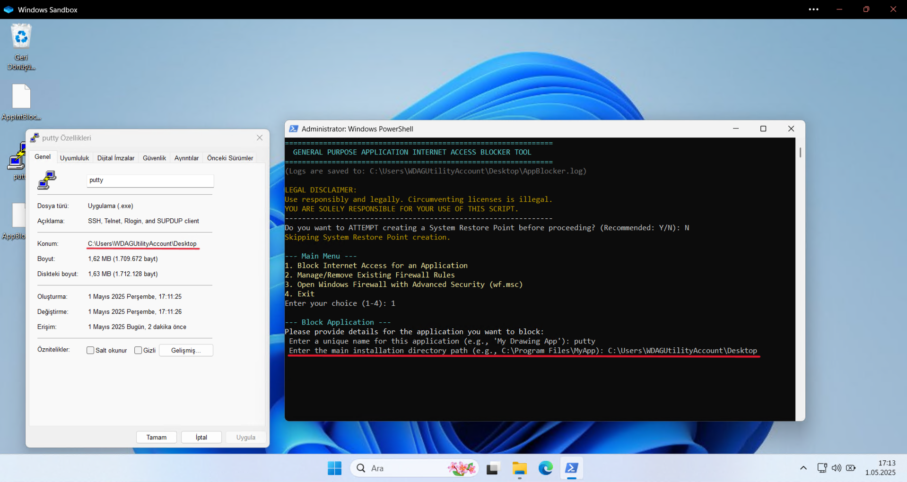
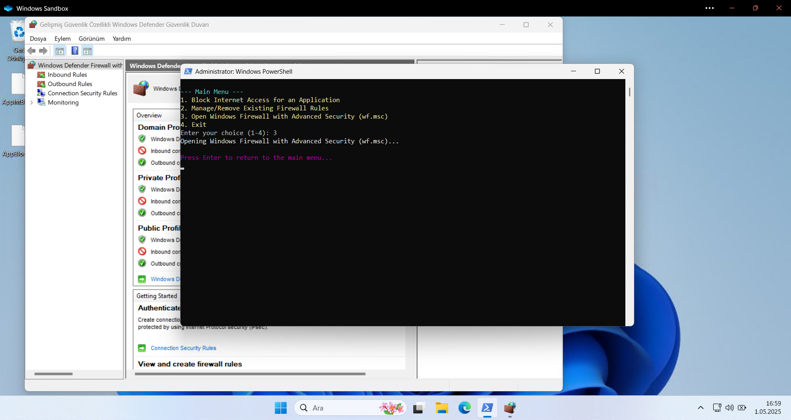
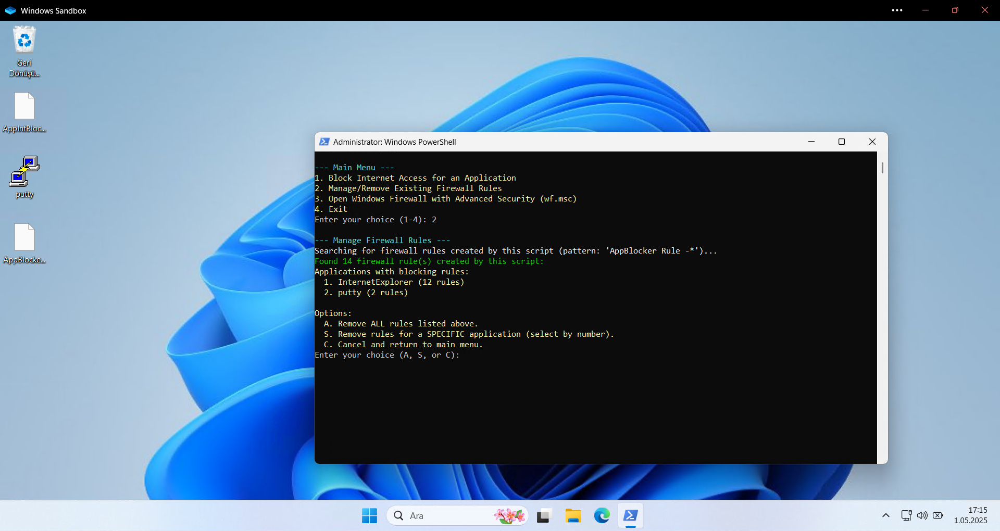
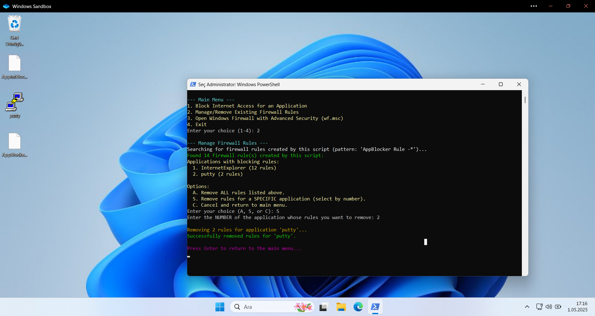
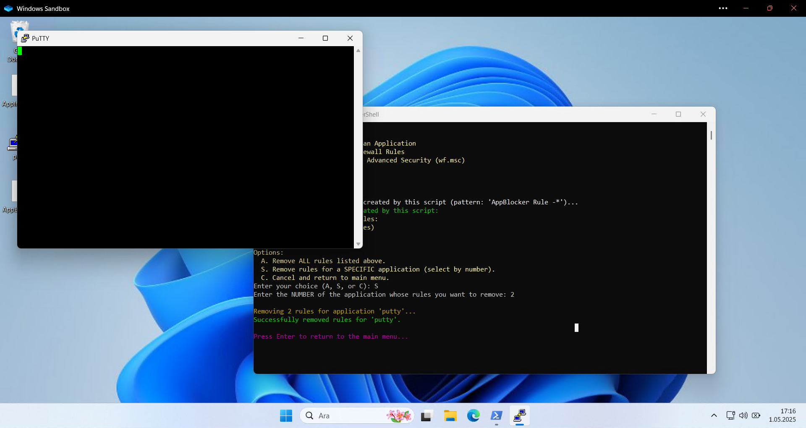

# AppIntBlocker

A PowerShell script that blocks an application's internet access on Windows. You give it the
application's folder; it adds a Windows Firewall rule for every `.exe` in it, and removes those rules
again when you ask. Nothing to install, no third-party tools.



## Usage

You need Windows 10 or 11 and an administrator account.

1. Download [`AppIntBlocker.ps1`](AppIntBlocker.ps1): open the file and click **Download raw file**.
2. Right-click the Start button and open **Terminal (Admin)** (on Windows 10: **Windows PowerShell (Admin)**).
3. Run the script from the folder you saved it to:

   ```powershell
   powershell -ExecutionPolicy Bypass -File "$HOME\Downloads\AppIntBlocker.ps1"
   ```

   `-ExecutionPolicy Bypass` lets this one run start; it changes no setting on your computer.
4. The script offers to back up your current firewall rules (recommended), then shows its menu:

| Option | What it does |
| --- | --- |
| **1** Block Internet Access for an Application | Asks for a name and the application's folder, then blocks every `.exe` in that folder and its subfolders. |
| **2** Manage/Remove Existing Firewall Rules | Lists the applications you blocked and removes the rules of one (**S**) or all of them (**A**). |
| **3** Open Windows Firewall with Advanced Security | Opens `wf.msc`. The script's rules are under Inbound and Outbound Rules, named `AppBlocker Rule -...`. |
| **4** Exit | |

### Example

Blocking an application installed in `C:\Program Files\Example`:

```text
Enter your choice (1-4): 1
 Enter a unique name for this application (e.g., 'My Drawing App'): Example
 Enter the main installation directory path (e.g., C:\Program Files\MyApp): C:\Program Files\Example
 Specify files or keywords to exclude from blocking? (Y/N): N
```

To find an application's folder, right-click its desktop shortcut and choose **Open file location**.
To give the application its internet access back, run the script again and choose **2**, then **S** and
the application's number.

<details>
<summary>Screenshots of a full run</summary>

Entering the application's name and folder:


Option 3 opens Windows Firewall with Advanced Security:


Option 2 lists the blocked applications and removes their rules:



After the rules are removed, the application connects again:


</details>

## How it works

Windows Firewall matches a rule to the program file of the process that opens a connection, which is
an `.exe`. The script adds two block rules, inbound and outbound, for each `.exe` in the folder. DLL
files run inside those programs, so they need no rules of their own.

- **Only firewall rules change.** Option 2 removes everything the script added. The backup is for
  anything else that goes wrong: it is saved next to the script as `FirewallBackup-<date>-<time>.wfw`,
  and `netsh advfirewall import "<that file>"` (as administrator) restores it. Importing replaces all
  current firewall rules with the backed-up ones, including rules other programs added since.
- **Logging:** every action and error goes to `AppBlocker.log` next to the script.
- **Limit:** an application that goes online through another program, such as a browser it opens or an
  updater installed in a different folder, needs that program blocked as well.

## Disclaimer

Use this script only on computers you are allowed to manage. It adds and removes Windows Firewall rules
and nothing else: it does not modify, patch or bypass the licensing of any software. The author is not
responsible for misuse.

## License

[MIT](LICENSE)

This script was developed with assistance from AI models: Claude 3.7 Sonnet and Gemini 2.5 Pro Preview.

It was later revised and updated with Claude Opus 5.5.
